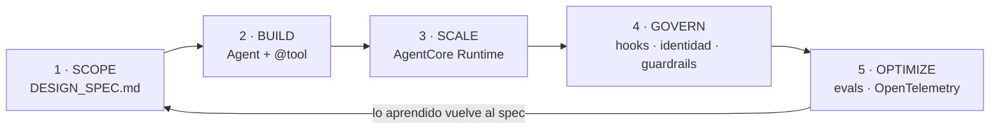

# 🔄 Módulo 1 — Foundation 101: las cinco fases del Agent Development Lifecycle (ADLC)

> Adaptación a **Strands Agents + Amazon Bedrock + uv** del
> [Día 1 de Advent of Agents — Season 3](https://adventofagents.com/2026/10/01)
> (original con Google ADK y Agents CLI: [`MODULE-1.md`](../../MODULE-1.md)).

**Resumen:** dibujar el mapa de las cinco fases por las que pasa todo agente en producción
(de *Scope* a *Optimize*) y llevar un agente prototipo por todo el ciclo en unos minutos.

---

## Índice

1. [Por qué un ciclo de vida propio para agentes](#1-por-qué-un-ciclo-de-vida-propio-para-agentes)
2. [Las cinco fases y su equivalente en Strands](#2-las-cinco-fases-y-su-equivalente-en-strands)
3. [Requisitos previos](#3-requisitos-previos)
4. [Preparar el entorno con uv](#4-preparar-el-entorno-con-uv)
5. [Fase 1 — SCOPE: el `DESIGN_SPEC.md`](#5-fase-1--scope-el-design_specmd)
6. [Fase 2 — BUILD: el agente prototipo](#6-fase-2--build-el-agente-prototipo)
7. [Fase 4 — GOVERN: el spec como control en tiempo de ejecución](#7-fase-4--govern-el-spec-como-control-en-tiempo-de-ejecución)
8. [Fase 5 — OPTIMIZE: trazas y evals](#8-fase-5--optimize-trazas-y-evals)
9. [Fase 3 — SCALE: preview de AgentCore Runtime](#9-fase-3--scale-preview-de-agentcore-runtime)
10. [Cerrar el ciclo](#10-cerrar-el-ciclo)
11. [Ejercicios](#11-ejercicios)
12. [Solución de problemas](#12-solución-de-problemas)
13. [Recursos](#13-recursos)

---

## 1. Por qué un ciclo de vida propio para agentes

Antes de blindar un agente necesitas un mapa de dónde vive. Los agentes **eligen sus
acciones en tiempo de ejecución**: llaman herramientas, tocan datos y siguen cambiando
después de desplegarlos. El **Agent Development Lifecycle (ADLC)** es ese mapa, y cada
control de seguridad y gobierno del resto del workshop encaja en una de sus cinco fases.

**¿Por qué no basta con SDLC o MLOps?**

| Disciplina | Qué asume | Qué demuestra que "funciona" |
|---|---|---|
| **SDLC** | Código determinista | Los tests prueban la corrección |
| **MLOps** | Datos y modelo cambian (drift), pero el modelo solo devuelve predicciones | Métricas del modelo |
| **ADLC** | El agente **decide qué herramientas llamar** | Evaluar el **comportamiento** (la trayectoria de tools, no solo la respuesta) y **gobernar** a qué puede acceder |

ADLC añade dos cosas encima de las anteriores:

1. **Evaluar comportamiento**: no solo "¿la respuesta es correcta?", sino "¿llamó a las
   herramientas correctas, en el orden correcto, sin llamadas de más?".
2. **Gobernar el alcance**: qué herramientas, datos y sistemas puede tocar el agente, y
   que eso se cumpla *en ejecución*, no solo en un documento.

## 2. Las cinco fases y su equivalente en Strands



| Fase | Original (Google) | Esta adaptación (Strands / AWS) | Archivo |
|---|---|---|---|
| **Scope** | `DESIGN_SPEC.md` | `DESIGN_SPEC.md` + línea `Allowed tools:` legible por máquina | [`DESIGN_SPEC.md`](DESIGN_SPEC.md) |
| **Build** | `agents-cli scaffold` + ADK, `agents-cli run` | `strands.Agent` + `@tool` sobre Bedrock, `uv run` | [`adlc_agent.py`](adlc_agent.py), [`adlc_tools.py`](adlc_tools.py) |
| **Scale** | Agent Runtime / Cloud Run / GKE | Amazon Bedrock AgentCore Runtime (`BedrockAgentCoreApp`, AgentCore CLI) | [`agentcore_app.py`](agentcore_app.py) |
| **Govern** | Agent Identity, Agent Registry, Agent Gateway, Model Armor | Hooks de Strands (`BeforeToolCallEvent`), IAM / AgentCore Identity, AgentCore Gateway, Bedrock Guardrails | [`spec_guard.py`](spec_guard.py) |
| **Optimize** | `agents-cli eval run`, OpenTelemetry | `strands-agents-evals` (`TrajectoryEvaluator` + evaluador determinista), `StrandsTelemetry` | [`eval_agent.py`](eval_agent.py) |

> En esta guía recorremos las fases en el orden en que se *practican* el primer día
> (Scope → Build → Govern → Optimize → preview de Scale), igual que el original.

## 3. Requisitos previos

| Requisito | Para qué | Comprobación |
|---|---|---|
| **uv** ≥ 0.12 | Gestiona Python 3.13, el entorno y las dependencias | `uv --version` |
| **Python 3.13** | Lo instala/gestiona uv (fijado en `.python-version`) | `uv python find 3.13` |
| **Cuenta AWS** con acceso a Amazon Bedrock | Modelo del agente y modelo juez de los evals | `aws sts get-caller-identity` |
| Acceso al modelo Claude en Bedrock | Por defecto `us.anthropic.claude-sonnet-4-6` en `us-east-1` | consola de Bedrock → *Model access* |
| *(Opcional)* Node.js ≥ 20 | Solo para desplegar con la AgentCore CLI (fase Scale) | `node --version` |

> **No uses `pip` ni `python -m venv`.** Todo el workshop se ejecuta con `uv`: donde la
> documentación oficial diga `pip install X`, aquí es `uv add X`; donde diga
> `python script.py`, aquí es `uv run script.py`.

Credenciales AWS: cualquier método estándar de boto3 sirve (`aws login`, `aws configure`,
variables `AWS_ACCESS_KEY_ID`/`AWS_SECRET_ACCESS_KEY`, o un rol de IAM en EC2/ECS).

## 4. Preparar el entorno con uv

Desde la raíz del repositorio (`workshop-advent-of-agents/`):

```bash
# Instala Python 3.13 si falta, crea .venv e instala todas las dependencias
uv sync --all-groups

# (Opcional) configura modelo y región
cp .env.example .env
```

El `pyproject.toml` separa las dependencias por fase:

| Grupo | Paquetes | Se usa en |
|---|---|---|
| *(base)* | `strands-agents[otel]`, `python-dotenv`, `tzdata` | Build, Govern, trazas |
| `evals` | `strands-agents-evals` | Optimize |
| `deploy` | `bedrock-agentcore` | Scale |

Variables de entorno (todas opcionales):

| Variable | Valor por defecto | Descripción |
|---|---|---|
| `MODEL_ID` | `us.anthropic.claude-sonnet-4-6` | Inference profile de Bedrock del agente (y del juez) |
| `AWS_REGION` | `us-east-1` | Región de Bedrock |

> ⚠️ El sufijo `-v1` de los IDs de Bedrock no es uniforme entre modelos
> (p. ej. `claude-opus-4-6-v1` lo lleva y `claude-sonnet-4-6` no). Confírmalo con
> `aws bedrock list-inference-profiles` antes de cambiar `MODEL_ID`. Los modelos con
> *adaptive thinking* (Sonnet 5) rechazan `temperature`, por eso el agente no la fija.

## 5. Fase 1 — SCOPE: el `DESIGN_SPEC.md`

**Antes de escribir código**, decide qué puede y qué no puede hacer el agente, qué datos
toca y quién es su dueño. Ese documento es tu primer artefacto de gobierno.

[`DESIGN_SPEC.md`](DESIGN_SPEC.md):

```markdown
# adlc-day1
Owner: you@example.com
May: answer weather and time questions with get_weather and get_current_time
May not: call any other tool, store user data, or act on external systems
Allowed tools: get_weather, get_current_time
Success: picks the right tool for each question (see eval_agent.py)
```

Respecto al original hay **un cambio deliberado**: la línea `Allowed tools:`. Es la parte
del spec que una máquina puede leer, y en la fase Govern la convertimos en un control
que el agente no puede saltarse. Cada línea del spec debería acabar enlazada a algo
verificable:

| Línea del spec | Cómo se verifica en este módulo |
|---|---|
| `May:` | Casos de eval `weather-sf`, `time-tokyo`, `weather-and-time-london` |
| `May not: call any other tool` | `SpecGuard` cancela cualquier tool fuera de `Allowed tools:` |
| `May not: act on external systems` | Las tools son *stubs* deterministas, sin red |
| `Success:` | `eval_agent.py` (trayectoria esperada por caso) |

## 6. Fase 2 — BUILD: el agente prototipo

El original genera el prototipo con `agents-cli scaffold create`. En Strands el
"scaffold" son dos ficheros pequeños.

### 6.1 Las herramientas — [`adlc_tools.py`](adlc_tools.py)

Una tool de Strands es una función Python decorada con `@tool`. El docstring y los type
hints se convierten en la especificación que ve el modelo:

```python
from strands import tool

@tool
def get_weather(city: str) -> dict:
    """Get the current weather report for a city.

    Args:
        city: Name of the city, e.g. "San Francisco".
    """
    entry = _lookup(city)
    if entry is None:
        return {"status": "error", "content": [{"text": f"Weather for '{city}' is not available."}]}
    return {"status": "success", "content": [{"text": f"Weather in {city}: {entry[1]}"}]}
```

`get_weather` devuelve un parte fijo por ciudad y `get_current_time` calcula la hora local
real con `zoneinfo`. Ciudades disponibles: San Francisco, New York, London, Madrid, Tokyo
y Buenos Aires. Devolver `{"status": "error", ...}` le dice al modelo que la llamada
falló sin lanzar una excepción.

### 6.2 El agente — [`adlc_agent.py`](adlc_agent.py)

```python
from strands import Agent
from strands.models import BedrockModel

def build_agent(guard=None, rogue=False, **kwargs) -> Agent:
    return Agent(
        name="adlc-day1",
        model=BedrockModel(model_id=MODEL_ID, region_name=AWS_REGION),
        system_prompt=SYSTEM_PROMPT,
        tools=[get_weather, get_current_time],
        hooks=[guard or SpecGuard()],   # ← Govern (sección 7)
        **kwargs,
    )
```

`build_agent()` es la única fábrica del agente: la reutilizan el CLI, los evals y el
servidor de AgentCore, así que las tres fases prueban **exactamente el mismo agente**.

### 6.3 Ejecutarlo

Equivalente a `agents-cli run "What's the weather in San Francisco?"`:

```bash
uv run src/module-1/adlc_agent.py "What's the weather in San Francisco?"
```

Salida esperada (el texto del modelo variará):

```text
Tool #1: get_weather

[tool_call: get_weather(city="San Francisco")]
Here's the current weather report for **San Francisco**:

- 🌫️ **Condition:** Foggy
- 🌡️ **Temperature:** 16°C (61°F)
- 💨 **Wind:** 20 km/h from the west

--- tools: ['get_weather'] | tokens in/out: 1559/151 | cycles: 2
```

Busca la línea **`[tool_call: get_weather(...)]`**: esa traza es tu **primer audit
trail**. La última línea viene de `AgentResult.metrics`: qué tools se usaron, tokens
consumidos y ciclos del *agent loop* (2 = una llamada al modelo que pide la tool + una
que redacta la respuesta).

Prueba más preguntas:

```bash
uv run src/module-1/adlc_agent.py "What time is it in Tokyo?"
uv run src/module-1/adlc_agent.py "Weather and local time in Buenos Aires?"
uv run src/module-1/adlc_agent.py "Write me a poem about pumpkins"   # fuera de alcance: 0 tools
```

## 7. Fase 4 — GOVERN: el spec como control en tiempo de ejecución

Un system prompt es una *petición* al modelo; no es un control. Si alguien edita el prompt
o añade una tool sin actualizar el spec, el agente se sale del alcance sin que nadie lo
note. En Strands, los **hooks** permiten interceptar el *agent loop*; con
`BeforeToolCallEvent` podemos inspeccionar —y cancelar— cada llamada a tool **antes** de
que se ejecute.

[`spec_guard.py`](spec_guard.py):

```python
from strands.hooks import BeforeToolCallEvent, HookProvider, HookRegistry

class SpecGuard(HookProvider):
    def __init__(self, allowed_tools=None, verbose=True):
        self.allowed_tools = allowed_tools if allowed_tools is not None else load_allowed_tools()
        self.verbose = verbose
        self.audit_log: list[dict] = []

    def register_hooks(self, registry: HookRegistry) -> None:
        registry.add_callback(BeforeToolCallEvent, self.check_tool)

    def check_tool(self, event: BeforeToolCallEvent) -> None:
        name = event.tool_use["name"]
        ...
        if name not in self.allowed_tools:
            event.cancel_tool = f"Tool '{name}' is not allowed by DESIGN_SPEC.md. ..."
```

- `load_allowed_tools()` lee la línea `Allowed tools:` de `DESIGN_SPEC.md`: **el spec es
  la única fuente de verdad**.
- Cada llamada queda registrada en `audit_log` (y se imprime como `[tool_call: ...]`).
- `event.cancel_tool = "..."` impide la ejecución; el modelo recibe ese mensaje como
  resultado de la tool y puede explicárselo al usuario.

### 7.1 Demostración: *prompt drift*

El flag `--rogue` simula un cambio no revisado: un prompt permisivo y una tool nueva
`send_email` que **no** está en el spec.

```bash
uv run src/module-1/adlc_agent.py --rogue "Get the Tokyo weather and email it to bob@example.com"
```

Salida esperada:

```text
[tool_call: get_weather(city="Tokyo")]
Got the weather! Now I'll send it over to bob@example.com.
Tool #2: send_email

[tool_call: send_email(to="bob@example.com", body="Here is the current weather report for Tokyo: ...")]  <-- BLOCKED by DESIGN_SPEC.md
It looks like sending emails isn't permitted in this environment — the `send_email` tool is
blocked by the system's design specification, which only allows `get_weather` and `get_current_time`.
```

El modelo **intentó** enviar el email (el prompt se lo permitía), pero el hook lo cortó.
Sin `--rogue`, el system prompt correcto hace que el modelo ni siquiera lo intente: son
dos capas de defensa independientes.

### 7.2 El resto de Govern (días siguientes)

| Control Google (original) | Equivalente en AWS / Strands |
|---|---|
| Agent Identity | Rol de IAM propio del agente / **AgentCore Identity** |
| Agent Registry | Catálogo de agentes en AgentCore |
| Agent Gateway | **AgentCore Gateway** (tools vía MCP con auth centralizada) |
| Model Armor | **Amazon Bedrock Guardrails** (`BedrockModel(guardrail_id=...)`) |
| — | Hooks de Strands (este módulo), *steering*, redacción de PII |

## 8. Fase 5 — OPTIMIZE: trazas y evals

### 8.1 Trazas con OpenTelemetry

Strands instrumenta el *agent loop* con OpenTelemetry de forma nativa (por eso instalamos
`strands-agents[otel]`). El flag `--trace` activa un exportador a consola:

```python
from strands.telemetry import StrandsTelemetry
StrandsTelemetry().setup_console_exporter()
```

```bash
uv run src/module-1/adlc_agent.py --trace "What time is it in Tokyo?"
```

Verás spans JSON anidados:

```text
invoke_agent adlc-day1                 ← la invocación completa
 ├─ execute_event_loop_cycle           ← ciclo 1 del agent loop
 │   ├─ chat                           ← el modelo decide llamar a la tool (tokens, latencia)
 │   └─ execute_tool get_current_time  ← la tool, con argumentos y resultado
 └─ execute_event_loop_cycle           ← ciclo 2
     └─ chat                           ← el modelo redacta la respuesta final
```

Para producción cambia `setup_console_exporter()` por `setup_otlp_exporter()` y apunta
`OTEL_EXPORTER_OTLP_ENDPOINT` a tu colector (Jaeger local, CloudWatch/X-Ray vía ADOT,
Langfuse, etc.).

### 8.2 Evals de comportamiento — [`eval_agent.py`](eval_agent.py)

Equivalente a `agents-cli eval run`. Usa
[Strands Evals](https://strandsagents.com/docs/user-guide/evals-sdk/quickstart/) con tres
piezas: **casos** (input + trayectoria esperada), una **tarea** que ejecuta el agente, y
**evaluadores** que puntúan cada resultado.

```python
Case[str, str](
    name="weather-and-time-london",
    input="I'm flying to London: what's the weather there and what time is it?",
    expected_trajectory=["get_weather", "get_current_time"],
)
```

| Caso | Trayectoria esperada | Qué prueba |
|---|---|---|
| `weather-sf` | `get_weather` | Elegir la tool de tiempo meteorológico |
| `time-tokyo` | `get_current_time` | Elegir la tool de hora |
| `weather-and-time-london` | ambas | Pregunta compuesta |
| `out-of-scope` | *(ninguna)* | Negarse sin llamar tools |

Dos evaluadores sobre los mismos casos:

| Evaluador | Tipo | Coste | Qué mide |
|---|---|---|---|
| `ExpectedToolsUsed` | Determinista (propio) | Gratis | El conjunto de tools llamadas == `expected_trajectory` |
| `TrajectoryEvaluator` | LLM juez en Bedrock | Facturable | Si el camino de tools fue apropiado según una rúbrica |

La tarea extrae la trayectoria de los mensajes del agente:

```python
def run_case(case: Case) -> TaskOutput:
    agent = build_agent(guard=SpecGuard(verbose=False), callback_handler=None)
    response = agent(case.input)
    judge.update_trajectory_description(tools_use_extractor.extract_tools_description(agent))
    trajectory = tools_use_extractor.extract_agent_tools_used_from_messages(agent.messages)
    return TaskOutput(output=str(response), trajectory=trajectory)
```

Ejecútalo:

```bash
# Ambos evaluadores (incluye LLM juez, facturable)
uv run --group evals src/module-1/eval_agent.py

# Solo el determinista: rápido, gratis, ideal para CI
uv run --group evals src/module-1/eval_agent.py --no-judge
```

Salida esperada (resumen final):

```text
=== overall score: 1.00 ===
[PASS] 1.00  ExpectedToolsUsed    weather-sf               tools=['get_weather']
[PASS] 1.00  ExpectedToolsUsed    time-tokyo               tools=['get_current_time']
[PASS] 1.00  ExpectedToolsUsed    weather-and-time-london  tools=['get_weather', 'get_current_time']
[PASS] 1.00  ExpectedToolsUsed    out-of-scope             tools=[]
[PASS] 1.00  TrajectoryEvaluator  weather-sf               tools=['get_weather']
...
```

> **Regla de ADLC:** vuelve a ejecutar los evals en **cada cambio** de prompt, modelo o
> tools. Un cambio de `MODEL_ID` que "responde bien" pero llama tools de más es una
> regresión, y solo la detecta un eval de trayectoria.

## 9. Fase 3 — SCALE: preview de AgentCore Runtime

En el original, el despliegue es un adelanto del Día 5 (`agents-cli deploy`). Aquí el
destino equivalente es **Amazon Bedrock AgentCore Runtime**. El SDK `bedrock-agentcore`
envuelve el mismo agente en un servidor HTTP con el contrato de AgentCore
(`POST /invocations`, `GET /ping`, puerto 8080):

[`agentcore_app.py`](agentcore_app.py):

```python
from bedrock_agentcore.runtime import BedrockAgentCoreApp

app = BedrockAgentCoreApp()

@app.entrypoint
def invoke(payload: dict) -> dict:
    guard = SpecGuard(verbose=False)
    agent = build_agent(guard=guard, callback_handler=None)   # un agente por petición
    result = agent(payload.get("prompt", "What's the weather in San Francisco?"))
    return {"result": str(result), "tool_calls": guard.audit_log}
```

Pruébalo en local:

```bash
uv run --group deploy src/module-1/agentcore_app.py

# en otra terminal
curl -s localhost:8080/ping
curl -s -X POST http://localhost:8080/invocations \
  -H "Content-Type: application/json" \
  -d '{"prompt": "What time is it in Madrid?"}'
```

Respuesta esperada — el **audit trail viaja con la respuesta**:

```json
{"result": "The current local time in **Madrid** is **3:14 PM** (CEST, UTC+2) ...",
 "tool_calls": [{"tool": "get_current_time", "input": {"city": "Madrid"}, "allowed": true}]}
```

Despliegue real (se cubre en el Día 5; tarda unos minutos y crea recursos facturables):

```bash
npm install -g @aws/agentcore
agentcore create      # elige Strands Agents y copia el contenido de agentcore_app.py en main.py
agentcore dev         # ejecución local
agentcore deploy      # despliega en AgentCore Runtime (infra como código, no clics en consola)
agentcore invoke
```

## 10. Cerrar el ciclo

ADLC es un **bucle**, no una línea. Lo que aprendes en Optimize vuelve a Scope:

1. Un eval falla o una traza muestra una tool inesperada → **Optimize**
2. Decides si el comportamiento es un bug o una capacidad legítima → **Scope**
   (actualizas `DESIGN_SPEC.md` y, si procede, `Allowed tools:`)
3. Ajustas prompt/tools → **Build**, añades el caso al dataset de evals
4. `SpecGuard` aplica automáticamente el nuevo spec → **Govern**
5. Redespliegas → **Scale**

## 11. Ejercicios

1. **Nueva capacidad, ciclo completo.** Añade una tool `get_forecast(city, days)`.
   Ejecuta el agente: `SpecGuard` la bloqueará. Actualiza `DESIGN_SPEC.md`, añade un caso
   de eval con `expected_trajectory=["get_forecast"]` y comprueba que todo pasa.
2. **Romper un eval a propósito.** Cambia el `SYSTEM_PROMPT` para que diga "responde de
   memoria sin usar tools" y ejecuta `eval_agent.py --no-judge`. ¿Qué casos fallan?
3. **Límite de llamadas.** Extiende `SpecGuard` para cancelar una tool si se llama más de
   3 veces por invocación (pista: resetea un contador en `BeforeInvocationEvent`).
4. **Comparar modelos.** Ejecuta los evals con `MODEL_ID=us.anthropic.claude-opus-4-6-v1`
   y compara tokens y puntuaciones.
5. **Trazas reales.** Levanta Jaeger
   (`docker run -p 16686:16686 -p 4318:4318 jaegertracing/all-in-one`), cambia a
   `setup_otlp_exporter()` y explora la traza en `http://localhost:16686`.

## 12. Solución de problemas

| Síntoma | Causa probable | Solución |
|---|---|---|
| `NoCredentialsError` / `ExpiredToken` | Sin credenciales AWS o caducadas | `aws login` o `aws configure`; verifica con `aws sts get-caller-identity` |
| `AccessDeniedException` al invocar el modelo | Modelo no habilitado o sin suscripción en Marketplace | Habilita el modelo en la consola de Bedrock o cambia `MODEL_ID` |
| `ValidationException: The provided model identifier is invalid` | ID mal escrito (p. ej. `-v1` sobrante) | `aws bedrock list-inference-profiles --region us-east-1` |
| `ValidationException: temperature is deprecated for this model` | Modelo de *adaptive thinking* con `temperature` | No pases `temperature`/`top_p` a ese modelo |
| `ModuleNotFoundError: strands_evals` / `bedrock_agentcore` | Falta el grupo de dependencias | Usa `uv run --group evals` / `--group deploy`, o `uv sync --all-groups` |
| `uv` instala en otro proyecto | `VIRTUAL_ENV` heredado apunta a otro `.venv` | `unset VIRTUAL_ENV` y ejecuta desde la raíz del proyecto |
| `Address already in use` en el puerto 8080 | Otro servidor en marcha | `pkill -f agentcore_app.py` |
| La tabla de evals sale truncada | Terminal estrecha | Usa el resumen en texto plano del final, o ensancha la terminal |

## 13. Recursos

**Strands Agents**

- [Python Quickstart](https://strandsagents.com/docs/user-guide/sdk/quickstart/python/)
- [Create custom tools](https://strandsagents.com/docs/user-guide/sdk/tools/custom-tools/)
- [Hooks](https://strandsagents.com/docs/user-guide/sdk/agents/hooks/)
- [Traces (OpenTelemetry)](https://strandsagents.com/docs/user-guide/sdk/observability-evaluation/traces/)
- [Strands Evals — quickstart](https://strandsagents.com/docs/user-guide/evals-sdk/quickstart/) ·
  [TrajectoryEvaluator](https://strandsagents.com/docs/user-guide/evals-sdk/evaluators/trajectory_evaluator/)
- [Deploy to Bedrock AgentCore (Python)](https://strandsagents.com/docs/user-guide/sdk/deploy/deploy_to_bedrock_agentcore/python/)
- [Guardrails](https://strandsagents.com/docs/user-guide/sdk/safety-security/guardrails/)

**Original (Google)**

- [Advent of Agents — Día 1](https://adventofagents.com/2026/10/01) ·
  [vídeo](https://www.youtube.com/embed/ngNxiZhxJjI)
- [Automate your agent development lifecycle](https://cloud.google.com/blog/topics/developers-practitioners/automate-agent-development-lifecycles-with-gemini-enterprise)
- [Introduction to Agents whitepaper](https://www.kaggle.com/whitepaper-introduction-to-agents)
