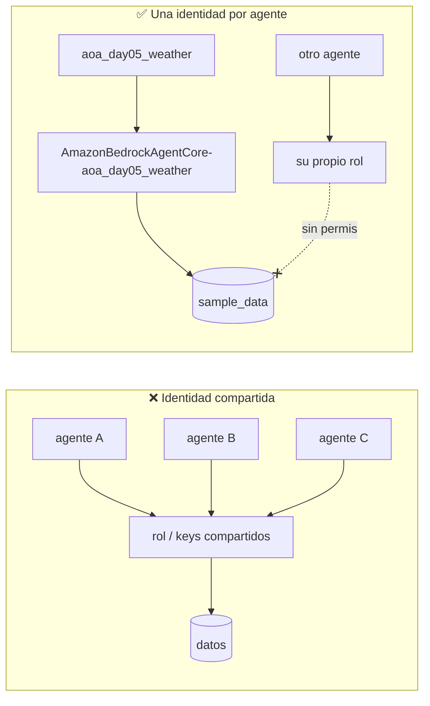

# 🪪 Módulo 5 — Agent Identity: una identidad por agente

> Adaptación a **Strands Agents + Amazon Bedrock AgentCore + uv** del
> [Día 5 de Advent of Agents — Season 3](https://adventofagents.com/2026/10/05)
> (original con Agent Identity/SPIFFE en Google Cloud: [`MODULE-5.md`](../../MODULE-5.md)).
> Modelo: **Claude Sonnet** en Bedrock (`us.anthropic.claude-sonnet-5` por defecto).

**Resumen:** desplegar un agente con **su propia identidad**, ver que sin permisos no
llega a nada, conceder permisos **a esa identidad** (no a una cuenta compartida) y
demostrar con CloudTrail **qué agente** hizo cada llamada.

---

## Índice

1. [El problema: una identidad compartida](#1-el-problema-una-identidad-compartida)
2. [Identidad de agente en AWS](#2-identidad-de-agente-en-aws)
3. [Equivalencias con el original](#3-equivalencias-con-el-original)
4. [Requisitos y coste](#4-requisitos-y-coste)
5. [El agente](#5-el-agente)
6. [Pasos 1–4 — Crear la identidad y desplegar](#6-pasos-14--crear-la-identidad-y-desplegar)
7. [Pasos 5–8 — Crear los datos](#7-pasos-58--crear-los-datos)
8. [Paso 9 — Confirmar que el agente tiene identidad propia](#8-paso-9--confirmar-que-el-agente-tiene-identidad-propia)
9. [Paso 10 — Ver cómo falla sin permisos](#9-paso-10--ver-cómo-falla-sin-permisos)
10. [Paso 11 — Conceder permisos al agente](#10-paso-11--conceder-permisos-al-agente)
11. [Paso 12 — Repetir el prompt](#11-paso-12--repetir-el-prompt)
12. [Paso 13 — Demostrar qué agente hizo la llamada](#12-paso-13--demostrar-qué-agente-hizo-la-llamada)
13. [Limpieza](#13-limpieza)
14. [Tests offline](#14-tests-offline)
15. [Ejercicios](#15-ejercicios)
16. [Solución de problemas](#16-solución-de-problemas)
17. [Recursos](#17-recursos)

---

## 1. El problema: una identidad compartida

Tres agentes de tu cuenta usan el mismo rol de IAM (o, peor, las mismas access keys).
Uno acaba de leer una tabla con datos de clientes. ¿Cuál fue? Con un principal compartido
**no se puede saber**: los tres firman sus peticiones con la misma identidad. Además:

- No puedes dar permisos distintos a cada agente: lo que concedes a uno, lo tienen todos.
- Unas access keys descargadas no caducan y pueden acabar en un repositorio.
- Cualquiera con `sts:AssumeRole` sobre el rol puede hacerse pasar por "los agentes".

Todo el gobierno de las sesiones siguientes (autorización, gateway, auditoría) se apoya en
poder responder a **"¿quién hizo esto?"**. Por eso el Día 5 arregla la capa de identidad.

## 2. Identidad de agente en AWS

En Amazon Bedrock AgentCore Runtime, cada agente tiene **dos identidades**, ambas propias:

| Identidad | Qué es | Para qué sirve |
|---|---|---|
| **Rol de ejecución** (`roleArn`) | Un rol de IAM que **solo AgentCore** puede asumir, y en este módulo **solo para runtimes con el nombre de este agente**. AgentCore entrega al agente credenciales STS temporales que se renuevan solas. | Firmar sus llamadas a AWS (Athena, S3, Bedrock...). Es la identidad que ve IAM y que registra CloudTrail. |
| **Workload identity** (`workloadIdentityArn`) | Identidad de AgentCore Identity que se crea automáticamente con cada runtime. | Obtener tokens OAuth/API keys hacia terceros y actuar en nombre del usuario (lo verás en el Día 6). |

Ninguna de las dos tiene material de clave que guardar: no hay JSON ni access keys que
descargar, filtrar o rotar a mano.



## 3. Equivalencias con el original

| Original (Google Cloud) | Esta adaptación (AWS) | Script |
|---|---|---|
| `agents-cli create` + `agent.py` con `BigQueryToolset` | Agente Strands con tools `list_tables` / `run_sql` sobre **Athena** | [`agent/main.py`](agent/main.py) |
| `agents-cli deploy --agent-identity` | Rol de ejecución **dedicado** + `CreateAgentRuntime` (direct code deploy) | [`deploy.py`](deploy.py) |
| SPIFFE ID + certificado X.509 rotado cada 24 h | Credenciales STS temporales del rol (renovación automática) + workload identity | — |
| Dataset BigQuery `sample_data.cities_weather` | Base de datos Glue `sample_data`, tabla `cities_weather` en S3, workgroup Athena `aoa-day05` | [`setup_data.py`](setup_data.py) |
| `gcloud ai reasoning-engines describe ... effectiveIdentity` | `GetAgentRuntime` → `roleArn` + `workloadIdentityArn` | [`show_identity.py`](show_identity.py) |
| Playground | `InvokeAgentRuntime` | [`invoke.py`](invoke.py) |
| `roles/bigquery.jobUser` + `roles/bigquery.dataViewer` en `principal://...` | Política inline mínima en **el rol del agente** (un workgroup, una base de datos, un prefijo S3) | [`grant.py`](grant.py) |
| Cloud Logging, `principalSubject` | CloudTrail Event history, `userIdentity.arn` | [`who_did_it.py`](who_did_it.py) |

> ¿Por qué Athena y no DynamoDB? Es lo más parecido a BigQuery (SQL sobre datos en un
> catálogo) y sus llamadas (`StartQueryExecution`) son *management events* de CloudTrail:
> aparecen en el Event history **sin configurar ningún trail**, lo que hace posible el
> paso 13 tal cual.

## 4. Requisitos y coste

- Todo lo del [README](../../README.md): `uv`, Python 3.13, credenciales AWS.
- Acceso a **Claude Sonnet** en Bedrock `us-east-1`. Por defecto `us.anthropic.claude-sonnet-5`;
  `us.anthropic.claude-sonnet-4-6` también sirve (`MODEL_ID=... uv run ...`).
- Permisos para crear: rol de IAM, bucket S3, workgroup de Athena, base de datos Glue y un
  AgentCore Runtime (por ejemplo `BedrockAgentCoreFullAccess` + IAM/S3/Glue/Athena en una
  cuenta de pruebas).

Instala dependencias:

```bash
uv sync --all-groups
```

**Coste:** pocos céntimos. Athena cobra por datos escaneados (la tabla ocupa bytes),
AgentCore Runtime por segundo de CPU/memoria activos, Bedrock por tokens. Ejecuta la
[limpieza](#13-limpieza) al acabar.

## 5. El agente

[`agent/main.py`](agent/main.py) es el `agent.py` del original traducido a Strands:

```python
MODEL_ID = os.getenv("MODEL_ID", "us.anthropic.claude-sonnet-5")
athena = boto3.client("athena", region_name=REGION)   # ← sin credenciales en el código

@tool
def run_sql(query: str) -> str:
    """Run a read-only SQL query (Athena / Trino dialect) on the analytics database."""
    if not READ_ONLY_SQL.match(query):
        return "ERROR: only read-only statements (SELECT, WITH, SHOW, DESCRIBE) are allowed."
    ...

app = BedrockAgentCoreApp()

@app.entrypoint
def invoke(payload: dict) -> dict:
    agent = Agent(model=BedrockModel(model_id=MODEL_ID, region_name=REGION),
                  tools=[get_weather, get_current_time, whoami, list_tables, run_sql], ...)
```

Claves:

- **El código no contiene credenciales.** `boto3` usa la identidad con la que se ejecute:
  en local, la tuya; en AgentCore Runtime, la del rol del agente. El mismo código, distinta
  identidad: por eso la identidad se decide **al desplegar**, no al programar.
- `whoami` llama a `sts:GetCallerIdentity`, que no necesita permisos: el agente puede decir
  con qué principal se ejecuta.
- `get_weather` / `get_current_time` son las mismas tools simuladas del original.
- Los modelos Sonnet con *adaptive thinking* rechazan `temperature`/`top_p`, por eso no se fijan.

Pruébalo en local (se ejecuta **como tú**):

```bash
uv run --group deploy src/module-5/agent/main.py
curl -s -X POST localhost:8080/invocations -H 'Content-Type: application/json' \
  -d '{"prompt": "Which AWS identity are you running as?"}'
```

La respuesta mostrará tu usuario o rol de operador, no el del agente: aún no está desplegado.

## 6. Pasos 1–4 — Crear la identidad y desplegar

Equivale a `agents-cli deploy --agent-identity`.

```bash
uv run src/module-5/deploy.py
```

`deploy.py` hace, en orden:

**1. Crea un rol dedicado** `AmazonBedrockAgentCore-aoa_day05_weather` con esta política de
confianza ([`policies.py`](policies.py)):

```json
{
  "Principal": {"Service": "bedrock-agentcore.amazonaws.com"},
  "Action": "sts:AssumeRole",
  "Condition": {
    "StringEquals": {"aws:SourceAccount": "<account>"},
    "ArnLike": {"aws:SourceArn": "arn:aws:bedrock-agentcore:us-east-1:<account>:runtime/aoa_day05_weather-*"}
  }
}
```

Ni personas ni otros servicios pueden asumirlo; tampoco **otros runtimes** de AgentCore.
Es lo que hace que la identidad sea *de este agente* y no reutilizable.

**2. Adjunta solo el baseline**: logs, trazas, métricas, invocar el modelo y pedir **su
propio** workload token (`workload-identity/aoa_day05_weather-*`). **Ningún permiso de
datos.** Tampoco `GetWorkloadAccessTokenForUserId`, que permitiría fabricar tokens para
cualquier usuario sin verificar su JWT.

**3. Empaqueta** `agent/` para **arm64** (la arquitectura de AgentCore Runtime) con uv:

```bash
uv pip install --python-platform aarch64-manylinux2014 --python-version 3.13 \
  --only-binary=:all: --target build/package -r agent/requirements.txt
```

y crea `build/deployment_package.zip` (~30 MB) con permisos 644/755.

**4. Crea (o actualiza) el runtime** con `CreateAgentRuntime` (*direct code deployment*,
`PYTHON_3_13`, `entryPoint: ["main.py"]`) y espera a `READY`. Guarda ARNs en `.state.json`.

## 7. Pasos 5–8 — Crear los datos

```bash
uv run src/module-5/setup_data.py
```

Se ejecuta **con tu identidad de operador**. Crea:

| Recurso | Nombre |
|---|---|
| Bucket S3 (acceso público bloqueado) | `aoa-day05-<account>-us-east-1` |
| CSV con 3 filas | `s3://.../data/cities_weather/cities_weather.csv` |
| Workgroup de Athena (resultados forzados a `s3://.../athena-results/`) | `aoa-day05` |
| Base de datos Glue + tabla externa | `sample_data.cities_weather` |

y termina con el equivalente de `bq head`:

```text
city          | state         | temp_f        | condition
New York      | NY            | 75            | Sunny
San Francisco | CA            | 60            | Foggy
Seattle       | WA            | 58            | Rainy
```

## 8. Paso 9 — Confirmar que el agente tiene identidad propia

```bash
uv run src/module-5/show_identity.py
```

```text
agent runtime        arn:aws:bedrock-agentcore:us-east-1:<account>:runtime/aoa_day05_weather-XXXXXXXXXX
execution role       arn:aws:iam::<account>:role/AmazonBedrockAgentCore-aoa_day05_weather
workload identity    arn:aws:bedrock-agentcore:us-east-1:<account>:workload-identity-directory/default/workload-identity/aoa_day05_weather-XXXXX

trusted principal    {'Service': 'bedrock-agentcore.amazonaws.com'}
...
data access          NONE (expected before STEP 11)
```

Este es el equivalente del `principal://agents.global.org-.../reasoningEngines/ENGINE_ID`
del original: un principal que existe solo para este agente.

## 9. Paso 10 — Ver cómo falla sin permisos

```bash
uv run src/module-5/invoke.py
# 🧑 Run a SQL query on sample_data.cities_weather to return all rows
```

**Falla**, y es lo esperado: el agente responde con un `AccessDeniedException` en el que
aparece **su** rol (`assumed-role/AmazonBedrockAgentCore-aoa_day05_weather/...`) como
principal al que se le niega `athena:StartQueryExecution`. Una identidad nueva solo tiene
su baseline; no lee tus datos hasta que tú lo decidas. **Ese valor por defecto es la
lección del día.**

Pregúntale también quién es:

```bash
uv run src/module-5/invoke.py "Which AWS identity are you running as?"
```

## 10. Paso 11 — Conceder permisos al agente

```bash
uv run src/module-5/grant.py
```

Adjunta `aoa-day05-athena-read` **al rol del agente** (equivalente a conceder
`bigquery.jobUser` + `bigquery.dataViewer` al `principal://` del agente):

| Sid | Acciones | Recurso | ≈ rol GCP |
|---|---|---|---|
| `RunQueriesInOneWorkgroup` | `athena:StartQueryExecution`, `GetQueryExecution`, `GetQueryResults`, ... | solo el workgroup `aoa-day05` | `bigquery.jobUser` |
| `ReadOneDatabaseCatalog` | `glue:GetDatabase`, `GetTable(s)`, `GetPartitions` | solo `sample_data` | `bigquery.dataViewer` |
| `ReadOneDatasetPrefix` | `s3:GetObject` | solo `data/*` | `bigquery.dataViewer` |
| `ListOnlyDataAndResults` / `LocateBucket` | `s3:ListBucket` (con condición de prefijo), `s3:GetBucketLocation` | el bucket | — |
| `WriteQueryResults` | `s3:PutObject`, `GetObject` | solo `athena-results/*` | — |

Ningún otro agente de la cuenta gana nada. Para retirarlo: `uv run src/module-5/grant.py --revoke`.

> Los cambios de IAM tardan unos segundos en propagarse; el script espera 15 s.

## 11. Paso 12 — Repetir el prompt

```bash
uv run src/module-5/invoke.py
```

Ahora vuelven las tres filas. **No ha cambiado nada del agente** (ni código, ni despliegue);
solo lo que su identidad puede alcanzar.

## 12. Paso 13 — Demostrar qué agente hizo la llamada

```bash
uv run src/module-5/who_did_it.py --wait
```

Consulta CloudTrail (`LookupEvents`, `EventName=StartQueryExecution` y `ListTableMetadata`)
y muestra quién hizo cada llamada sobre el workgroup `aoa-day05`:

```text
2026-10-18T14:05:12Z  StartQueryExecution  AccessDenied           AGENT arn:aws:sts::<account>:assumed-role/AmazonBedrockAgentCore-aoa_day05_weather/<session>
2026-10-18T14:07:40Z  StartQueryExecution  OK                     AGENT arn:aws:sts::<account>:assumed-role/AmazonBedrockAgentCore-aoa_day05_weather/<session>
                      query: SELECT * FROM cities_weather
```

`userIdentity.arn` es el equivalente de `principalSubject`: nombra **el rol de este agente**,
así que "¿qué agente hizo esto?" tiene respuesta inmediata — incluido el intento fallido
del paso 10. Tus propias consultas de `setup_data.py` aparecen como `other`.

> CloudTrail puede tardar ~5 minutos en mostrar eventos nuevos; `--wait` reintenta
> durante 10 minutos. En la consola: CloudTrail → Event history → filtro
> *Event name = StartQueryExecution* → columna *User name*.

## 13. Limpieza

```bash
uv run src/module-5/cleanup.py
```

Borra el runtime, el rol (y sus políticas), el workgroup, la tabla y base de datos Glue, y
el bucket con todo su contenido. Es idempotente: lo que no exista se omite.

## 14. Tests offline

Sin credenciales ni llamadas a AWS:

```bash
uv run --group dev --group deploy pytest src/module-5 -q
```

Comprueban que la confianza solo admite AgentCore para este agente, que el baseline no da
acceso a datos, que el workload token está acotado a este agente, que la concesión no usa
`"*"` y solo escribe en `athena-results/`, y que el guard SQL del agente rechaza
`DROP`/`INSERT`/`CREATE`.

## 15. Ejercicios

1. **El problema original.** Despliega un segundo agente con `AGENT_NAME=aoa_day05_other`
   y comprueba que no puede leer `sample_data` aunque el primero sí. Después, intenta
   desplegarlo reutilizando el rol del primero: la condición `aws:SourceArn` lo impide.
2. **Revocar en caliente.** Ejecuta `grant.py --revoke` y repite `invoke.py`: el agente pierde
   el acceso sin redesplegar.
3. **Más estrecho todavía.** Cambia `ReadOneDatabaseCatalog` para permitir solo la tabla
   `cities_weather` (no `table/sample_data/*`) y crea una segunda tabla: el agente no debe verla.
4. **Defensa en profundidad.** Quita el guard `READ_ONLY_SQL` y pide al agente un
   `CREATE TABLE ... AS SELECT`. ¿Qué lo frena ahora? (Pista: qué prefijos puede escribir.)
5. **Workload identity.** Ejecuta
   `aws bedrock-agentcore-control get-workload-identity --name <nombre>` con el nombre del
   `workloadIdentityArn`: es la identidad que el Día 6 usará para delegación de usuario.

## 16. Solución de problemas

| Síntoma | Causa probable | Solución |
|---|---|---|
| `ExpiredToken` / `NoCredentialsError` | Credenciales del operador caducadas | `aws login` y repite |
| `AccessDeniedException` en `deploy.py` (`iam:CreateRole`, `PassRole`) | Tu usuario no puede crear/pasar roles | Usa una cuenta de pruebas con permisos de IAM o pide el rol a un admin |
| Runtime en `CREATE_FAILED` | Paquete no arm64, o modelo/rol inválido | Mira `failureReason`; borra `build/` y repite `deploy.py` |
| `AccessDeniedException` del modelo en el agente desplegado | El modelo Sonnet no está habilitado para la cuenta | Prueba `MODEL_ID=us.anthropic.claude-sonnet-4-6` y vuelve a `deploy.py` |
| El paso 12 sigue fallando justo tras `grant.py` | Propagación de IAM | Espera 30 s y repite |
| `who_did_it.py` no muestra nada | Retraso de CloudTrail | Usa `--wait` o espera ~5 min |
| `ValidationException` sobre `runtimeSessionId` | ID de sesión corto | Debe tener ≥ 33 caracteres (`invoke.py` ya lo cumple) |

## 17. Recursos

- [IAM Permissions for AgentCore Runtime](https://docs.aws.amazon.com/bedrock-agentcore/latest/devguide/runtime-permissions.html)
- [Direct code deployment for Python](https://docs.aws.amazon.com/bedrock-agentcore/latest/devguide/runtime-get-started-code-deploy-python.html)
- [AgentCore Identity](https://docs.aws.amazon.com/bedrock-agentcore/latest/devguide/identity.html)
- [Deploy Strands agents to Bedrock AgentCore (Python)](https://strandsagents.com/docs/user-guide/sdk/deploy/deploy_to_bedrock_agentcore/python/)
- [CloudTrail Event history](https://docs.aws.amazon.com/awscloudtrail/latest/userguide/view-cloudtrail-events.html)
- Original: [Advent of Agents — Día 5](https://adventofagents.com/2026/10/05) ·
  [vídeo](https://www.youtube.com/embed/0z7kizuaB0M)
