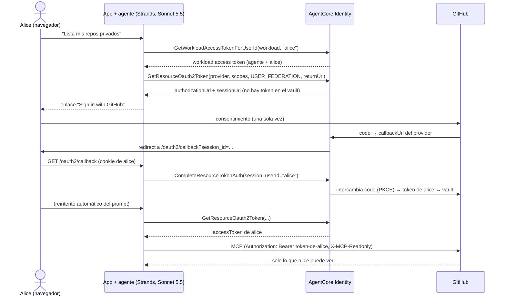

# 🎫 Módulo 6 — Token Delegation: el agente actúa en nombre del usuario

> Adaptación a **Strands Agents + Amazon Bedrock AgentCore Identity + uv** del
> [Día 6 de Advent of Agents — Season 3](https://adventofagents.com/2026/10/06)
> (original con Agent Identity *auth manager* en Google Cloud: [`MODULE-6.md`](../../MODULE-6.md)).
> Modelo: **Claude Sonnet 5.5** en Bedrock (`us.anthropic.claude-sonnet-5-5`).

**Resumen:** dar al agente acceso a una herramienta externa (GitHub) **como el usuario que
ha iniciado sesión**, para que solo vea lo que ese usuario puede ver.

---

## Índice

1. [El problema: un token para todos](#1-el-problema-un-token-para-todos)
2. [AgentCore Identity: credential provider + token vault](#2-agentcore-identity-credential-provider--token-vault)
3. [Equivalencias con el original](#3-equivalencias-con-el-original)
4. [Qué pasa por debajo 👻](#4-qué-pasa-por-debajo-)
5. [Requisitos](#5-requisitos)
6. [Paso 5 — La identidad del agente](#6-paso-5--la-identidad-del-agente)
7. [Pasos 6–7 — Crear el auth provider y leer el callback](#7-pasos-67--crear-el-auth-provider-y-leer-el-callback)
8. [Paso 8 — Registrar la OAuth App en GitHub](#8-paso-8--registrar-la-oauth-app-en-github)
9. [Paso 9 — Guardar client ID y secret en el provider](#9-paso-9--guardar-client-id-y-secret-en-el-provider)
10. [Pasos 10–11 — Conceder acceso al agente y a ti](#10-pasos-1011--conceder-acceso-al-agente-y-a-ti)
11. [Paso 12 — Probarlo con la app](#11-paso-12--probarlo-con-la-app)
12. [El código](#12-el-código)
13. [Auditoría: ambas identidades en CloudTrail](#13-auditoría-ambas-identidades-en-cloudtrail)
14. [Llevarlo a AgentCore Runtime](#14-llevarlo-a-agentcore-runtime)
15. [Tests offline](#15-tests-offline)
16. [Limpieza](#16-limpieza)
17. [Ejercicios](#17-ejercicios)
18. [Solución de problemas](#18-solución-de-problemas)
19. [Recursos](#19-recursos)

---

## 1. El problema: un token para todos

Dos personas preguntan a tu agente de soporte lo mismo: *"enséñame mis tickets abiertos"*.
Las dos reciben la misma lista, porque el agente tiene **un** token de Jira que ve todos los
tickets. Decirle al modelo *"filtra por usuario"* en el system prompt **no es control de
acceso: es una sugerencia**. El agente tiene que llamar a Jira (o GitHub) **como la persona
que pregunta**, y que sea Jira quien aplique sus permisos.

Para eso hace falta un token OAuth **por usuario** y un sitio seguro donde guardarlo. En AWS
eso es **AgentCore Identity**: guarda el client secret de OAuth, lanza el flujo de
consentimiento, custodia el token de cada usuario en un **token vault** y lo renueva. El
código del agente **nunca toca el client secret**.

Se apoya en el Día 5: el agente se autentica ante AgentCore Identity **como él mismo** (su
*workload identity*) y toma prestada la autoridad del usuario para la llamada saliente, así
que **ambas identidades** quedan en la auditoría.

## 2. AgentCore Identity: credential provider + token vault

| Pieza | Qué es | En este módulo |
|---|---|---|
| **OAuth2 credential provider** | La configuración de la app OAuth de terceros (GitHub). El client secret se guarda en Secrets Manager, gestionado por AgentCore. | `github-oauth-provider` |
| **Workload identity** | La identidad del agente (en Runtime se crea sola por cada agente, Día 5). Declara a qué URLs de la app puede volver el usuario tras consentir. | `aoa_day06_devops` |
| **Workload access token** | Token de corta duración = **agente + usuario**. Se pide con `GetWorkloadAccessTokenForJWT` (token del IdP del usuario) o `...ForUserId`. | `Delegation.workload_token()` |
| **Token vault** | Almacén de tokens OAuth por (agente, usuario, provider). | gestionado |
| **Session binding URL** | Endpoint **de tu app** que confirma que quien vuelve del consentimiento es quien lo inició (`CompleteResourceTokenAuth`). | `GET /oauth2/callback` |

## 3. Equivalencias con el original

| Original (Google Cloud) | Esta adaptación (AWS) | Archivo |
|---|---|---|
| Agente ADK + `McpToolset` con `GcpAuthProviderScheme` | Agente Strands + `MCPClient(url, headers={"Authorization": ...})` | [`devops_agent.py`](devops_agent.py) |
| Agent Identity (SPIFFE) del agente | Workload identity de AgentCore (+ rol de ejecución del Día 5) | [`setup_identity.py`](setup_identity.py) `workload` |
| `gcloud agent-identity auth-providers create` | `CreateOauth2CredentialProvider` (vendor `GithubOauth2`) | `setup_identity.py provider` |
| `redirectUrl` del provider | `callbackUrl` del provider | `setup_identity.py show` |
| `auth-providers update --client-id --client-secret` | `UpdateOauth2CredentialProvider` | `setup_identity.py provider --client-id ...` |
| `roles/agentidentity.user` al agente y a ti | Política IAM: `GetWorkloadAccessToken*`, `GetResourceOauth2Token`, `CompleteResourceTokenAuth`, secreto del provider | [`policies.py`](policies.py), [`grant.py`](grant.py) |
| `adk_request_credential` + `auth_uri` | `GetResourceOauth2Token` → `authorizationUrl` + `sessionUri` | [`delegation.py`](delegation.py) |
| `continue_uri` (`/validateUserId`) | `resourceOauth2ReturnUrl` (`/oauth2/callback`) + `CompleteResourceTokenAuth` | [`app.py`](app.py) |
| Sample UI client (puerto 8501) | App FastAPI (puerto 8501) | [`app.py`](app.py) |
| `RetrieveCredentials` en Cloud Audit Logs | `GetResourceOauth2Token` / `CompleteResourceTokenAuth` en CloudTrail | [`who_fetched.py`](who_fetched.py) |

## 4. Qué pasa por debajo 👻



En las llamadas siguientes el token sale directamente del vault (sin consentimiento) y
AgentCore lo renueva cuando caduca.

## 5. Requisitos

- Todo lo del [README](../../README.md): `uv`, Python 3.13, credenciales AWS (`uv sync --all-groups`).
- Acceso a **Claude Sonnet 5.5** en Bedrock `us-east-1` (`MODEL_ID` para usar otro Sonnet).
- Una cuenta de **GitHub** donde puedas registrar una OAuth App.
- Coste: AgentCore Identity no tiene coste por los recursos de este módulo; pagas los tokens
  de Bedrock del agente.

## 6. Paso 5 — La identidad del agente

En el original, el paso 5 despliega el agente con Agent Identity. Aquí la app ejecuta el
agente en local, así que creamos su **workload identity** explícitamente (en AgentCore Runtime
se crea sola con el runtime, ver [§14](#14-llevarlo-a-agentcore-runtime)) y registramos la
URL de *session binding* de la app:

```bash
uv run src/module-6/setup_identity.py workload
```

```text
created workload identity aoa_day06_devops
{
  "workloadIdentityArn": "arn:aws:bedrock-agentcore:us-east-1:<account>:workload-identity-directory/default/workload-identity/aoa_day06_devops",
  "allowedResourceOauth2ReturnUrls": ["http://localhost:8501/oauth2/callback"]
}
```

> `http://localhost` vale para pruebas locales. En producción la URL de session binding debe
> ser **HTTPS pública** (`OAUTH_RETURN_URL=https://tu-app/oauth2/callback`).

## 7. Pasos 6–7 — Crear el auth provider y leer el callback

Igual que en el original, el provider se crea **antes** de tener client ID/secret, porque
GitHub no los emite hasta conocer la URL de callback:

```bash
uv run src/module-6/setup_identity.py provider
```

```text
created credential provider github-oauth-provider

callback URL (register it as the GitHub 'Authorization callback URL'):
  https://bedrock-agentcore.us-east-1.amazonaws.com/identities/oauth2/callback/<uuid>
```

Para volver a leerla: `uv run src/module-6/setup_identity.py show`.

> **No confundas las dos URLs.** La *callback URL* apunta a AgentCore Identity y se registra
> en GitHub (allí llega el `code`). La *session binding URL* (`/oauth2/callback` de tu app) se
> registra en la workload identity (allí vuelve el navegador del usuario).

## 8. Paso 8 — Registrar la OAuth App en GitHub

En [GitHub → Settings → Developer settings → OAuth Apps](https://github.com/settings/developers)
→ **New OAuth App**:

| Campo | Valor |
|---|---|
| Application name | `aoa-day06-devops` (cualquiera) |
| Homepage URL | `http://localhost:8501` |
| Authorization callback URL | la **callback URL** del paso 7, copiada exactamente |

**Register application** → **Generate a new client secret**. Guarda el *Client ID* y el
*Client secret*. Si la callback no coincide exactamente, GitHub mostrará
*"The redirect_uri is not associated with this application"*.

## 9. Paso 9 — Guardar client ID y secret en el provider

```bash
uv run src/module-6/setup_identity.py provider --client-id <CLIENT_ID> --client-secret <CLIENT_SECRET>
```

El secreto va directo a AgentCore Identity, que lo guarda en Secrets Manager
(`bedrock-agentcore-identity!default/oauth2/github-oauth-provider-...`). Ni la app ni el
agente lo leen nunca.

## 10. Pasos 10–11 — Conceder acceso al agente y a ti

Equivale a `roles/agentidentity.user` sobre el provider. La política
([`policies.py`](policies.py)) solo permite actuar como **esta** workload y leer tokens de
**este** provider:

| Sid | Acciones | Recurso |
|---|---|---|
| `ActAsThisWorkloadForAUser` | `GetWorkloadAccessTokenForJWT`, `...ForUserId` | solo `workload-identity/aoa_day06_devops` |
| `ReadUserTokensFromOneProvider` | `GetResourceOauth2Token`, `CompleteResourceTokenAuth` | el token vault + `oauth2credentialprovider/github-oauth-provider` + la workload |
| `ProviderClientSecretViaAgentCoreOnly` | `secretsmanager:GetSecretValue` | solo el secreto de este provider, con la etiqueta `owningService = bedrock-agentcore-identity` |

```bash
uv run src/module-6/grant.py --print                                        # ver la política
uv run src/module-6/grant.py --role AmazonBedrockAgentCore-aoa_day05_weather  # paso 10: el agente del Día 5
uv run src/module-6/grant.py --role <TU_ROL>                                 # paso 11: tú, para ejecutar en local
```

Si tu rol ya tiene permisos amplios de AgentCore (por ejemplo `BedrockAgentCoreFullAccess`),
el paso 11 no hace falta. Sin él, `GetResourceOauth2Token` devuelve `AccessDeniedException`
(el equivalente al 403 en `retrieveCredentials` del original).

> En producción concede solo `...ForJWT` y deniega explícitamente `...ForUserId`: con
> `ForUserId` quien tenga el permiso puede *afirmar* ser cualquier usuario. Aquí lo usamos
> porque el login de la app es simulado.

## 11. Paso 12 — Probarlo con la app

```bash
uv run src/module-6/app.py     # http://localhost:8501
```

1. Inicia sesión como **alice** (el IdP está simulado con una cookie firmada).
2. Envía: *"List my contribution across my private github repositories over the last 3 months."*
3. El agente no tiene token para alice → aparece **🔐 Sign in with GitHub**. Púlsalo, acepta
   en GitHub (una sola vez).
4. GitHub → AgentCore → tu `/oauth2/callback` → la app comprueba que la cookie es de alice y
   llama a `CompleteResourceTokenAuth` → vuelve a la página y reenvía el prompt.
5. El agente responde con **tus** repos privados: los ve porque tú los ves.

En la terminal de la app verás el rastro de delegación:

```text
  [delegation] agent=aoa_day06_devops user=alice      consent-required   no GitHub token in the vault yet
  [delegation] agent=aoa_day06_devops user=alice      session-bound      token stored in the vault for this user
  [delegation] agent=aoa_day06_devops user=alice      token-from-vault   calling GitHub MCP as the user
```

Ahora cierra sesión y entra como **bob**: vuelve a pedir consentimiento, porque el vault
guarda tokens **por usuario**. Si bob consiente con otra cuenta de GitHub, verá otros repos
con el mismo agente y el mismo prompt. Eso es exactamente lo que el system prompt no podía
garantizar.

### Lo que se verificó al escribir esta guía

| Comprobación | Resultado |
|---|---|
| `setup_identity.py workload` / `provider` / `show` | recursos creados; callback URL y ARN del secreto mostrados |
| `GetResourceOauth2Token` para alice y bob | cada uno recibe **su propia** `authorizationUrl` + `sessionUri` |
| Seguir la `authorizationUrl` | `302` a `github.com/login/oauth/authorize` con `client_id`, `redirect_uri` = callback de AgentCore, `scope=repo read:user` y **PKCE** (`code_challenge_method=S256`) |
| `/oauth2/callback` sin sesión iniciada | `401`, no se vincula nada |
| bob intenta completar la sesión de alice | AgentCore responde `AccessDeniedException: Invalid or expired session` → `403` |
| Agente + MCP de GitHub con un token de usuario real | `get_me` → devuelve el login de ese usuario; el servidor en modo read-only expone 27 tools, todas de lectura |

El consentimiento final en GitHub requiere tu OAuth App (pasos 8–9).

## 12. El código

### 12.1 Delegación — [`delegation.py`](delegation.py)

```python
def token_for(self, user_id, workload_token=None, force=False) -> TokenResult:
    response = self.client.get_resource_oauth2_token(
        forceAuthentication=force,
        workloadIdentityToken=workload_token or self.workload_token(user_id),  # agente + usuario
        resourceCredentialProviderName=self.provider,
        scopes=SCOPES,                       # ["repo", "read:user"]
        oauth2Flow="USER_FEDERATION",        # 3-legged OAuth en nombre del usuario
        resourceOauth2ReturnUrl=RETURN_URL,  # session binding de la app
    )
    if token := response.get("accessToken"):
        return TokenResult(token=token)
    return TokenResult(consent_url=response["authorizationUrl"], session_uri=response.get("sessionUri"))
```

No usamos el *poller* bloqueante del SDK (`@requires_access_token`), que espera hasta
10 minutos dentro de la petición: en una app web es mejor devolver la URL y continuar cuando
el usuario vuelva.

### 12.2 Session binding — [`app.py`](app.py)

```python
@app.get("/oauth2/callback")
def oauth2_callback(request: Request, session_id: str | None = None):
    user = signed_in_user(request)          # de la cookie de sesión de la app, no de la URL
    if not user:
        return HTMLResponse("Sign in to the app before completing consent.", status_code=401)
    delegation.complete(session_id, user)   # AgentCore exige que coincida con quien inició
    return RedirectResponse("/?consented=1", status_code=303)
```

Esto evita que un enlace de consentimiento reenviado por error acabe dando a otra persona
el acceso a tu GitHub. La URL y la sesión caducan a los 10 minutos.

### 12.3 El agente — [`devops_agent.py`](devops_agent.py)

```python
def github_mcp(user_token: str) -> MCPClient:
    return MCPClient(
        url="https://api.githubcopilot.com/mcp/",
        headers={
            "Authorization": f"Bearer {user_token}",  # el token del USUARIO, no del agente
            "X-MCP-Toolsets": "repos,issues,pull_requests,users,context",
            "X-MCP-Readonly": "true",
        },
    )

Agent(model=BedrockModel(model_id="us.anthropic.claude-sonnet-5-5"), system_prompt=INSTRUCTION,
      tools=[github_mcp(token)], hooks=[ReadOnlyGuard()])
```

Solo lectura en **dos capas**: el modo read-only del servidor y el hook `ReadOnlyGuard`,
que cancela cualquier tool con verbo de escritura (`create_`, `merge_`, `push_`,
`delete_`, ...). Si GitHub rechaza el token (revocado), la app pide consentimiento de nuevo
con `forceAuthentication`.

## 13. Auditoría: ambas identidades en CloudTrail

Las llamadas de AgentCore Identity son *management events* de
`bedrock-agentcore.amazonaws.com`:

| Evento | Quién llama (`userIdentity.arn`) | Contexto (`requestParameters`) |
|---|---|---|
| `GetWorkloadAccessTokenForUserId` / `ForJWT` | el principal IAM de la app / agente | `workloadName` (+ usuario) |
| `GetResourceOauth2Token` | el principal IAM de la app / agente | provider, scopes, `oauth2Flow` (tokens redactados) |
| `CompleteResourceTokenAuth` | el principal IAM de la app | — |

```bash
uv run src/module-6/who_fetched.py
```

En la consola: **CloudTrail → Event history → Event source = `bedrock-agentcore.amazonaws.com`**.
El lado del usuario queda en GitHub (*Settings → Applications → Authorized OAuth Apps* y el
audit log de la organización), que registra las llamadas como el usuario.

> En la cuenta de workshop usada para esta guía el rol no tenía `cloudtrail:LookupEvents`;
> el script lo detecta y sugiere la consola.

## 14. Llevarlo a AgentCore Runtime

El mismo flujo funciona con el agente desplegado como en el Día 5:

1. AgentCore Runtime crea **automáticamente** una workload identity por runtime
   (`workloadIdentityArn` en `GetAgentRuntime`). Registra en ella tu URL de session binding:
   `uv run src/module-6/setup_identity.py workload --name <nombre-de-esa-workload> --return-url https://tu-app/oauth2/callback`.
2. Concede la política al **rol de ejecución** del agente (paso 10).
3. Invoca el runtime con `runtimeUserId=<usuario>` (o con inbound JWT): AgentCore inyecta el
   workload access token de *agente + usuario* en la petición, y dentro del agente se pasa a
   `Delegation.token_for(user, workload_token=BedrockAgentCoreContext.get_workload_access_token())`.
4. La app sigue sirviendo `/oauth2/callback` y llamando a `CompleteResourceTokenAuth`.

## 15. Tests offline

```bash
uv run --group dev pytest src/module-6 -q
```

26 tests con un AgentCore Identity simulado (vault por usuario): primer uso → consentimiento;
después, token del vault; bob no hereda el token de alice; el callback rechaza usuarios no
autenticados, cookies falsificadas y usuarios distintos del que inició la sesión; el guard
deja pasar las tools de lectura reales y cancela las de escritura; la política IAM no usa `"*"`.

## 16. Limpieza

```bash
uv run src/module-6/cleanup.py                      # provider (+ secreto y tokens del vault) y workload identity
uv run src/module-6/grant.py --role <ROL> --revoke  # por cada rol al que concediste
```

Y en GitHub, borra la OAuth App (o revoca su acceso en *Authorized OAuth Apps*).

## 17. Ejercicios

1. **Dos usuarios, dos vistas.** Consiente como alice con tu cuenta y como bob con otra cuenta
   de GitHub (o una de prueba). Mismo prompt, respuestas distintas.
2. **Revoca en GitHub.** En *Authorized OAuth Apps* revoca la app y repite el prompt: la app
   detecta el rechazo y pide consentimiento de nuevo.
3. **Mínimo privilegio en OAuth.** Cambia `SCOPES` a `["read:user", "public_repo"]`: el agente
   deja de ver repos privados aunque el usuario los tenga.
4. **CSRF.** Añade `customState` (un valor firmado ligado a la cookie) a `GetResourceOauth2Token`
   y valídalo en `/oauth2/callback`.
5. **IdP real.** Sustituye el login simulado por Amazon Cognito y usa
   `GetWorkloadAccessTokenForJWT` + `CompleteResourceTokenAuth(userIdentifier={"userToken": ...})`.

## 18. Solución de problemas

| Síntoma | Causa probable | Solución |
|---|---|---|
| GitHub: *redirect_uri is not associated with this application* | La callback de la OAuth App no es la del provider | Copia exacta de `setup_identity.py show` |
| GitHub: *client_id is invalid* / 404 | El provider aún tiene el placeholder | Paso 9 |
| `AccessDeniedException` en `GetResourceOauth2Token` | Falta la política del paso 10/11 | `grant.py --role <ROL>` |
| `ValidationException` sobre `resourceOauth2ReturnUrl` | La URL no está registrada en la workload | `setup_identity.py workload` (con `--return-url`) |
| Callback → `403 Invalid or expired session` | Pasaron más de 10 min, o completa otro usuario | Repite el prompt para generar un enlace nuevo |
| Callback → `401` | El navegador que vuelve no tiene la cookie de la app | Usa el mismo navegador en el que iniciaste sesión |
| `Failed to start MCP client` | Token revocado/caducado o sin acceso al MCP de GitHub | La app fuerza nuevo consentimiento; comprueba la OAuth App |
| `who_fetched.py` → falta `cloudtrail:LookupEvents` | Rol sin permiso de lectura de CloudTrail | Consola de CloudTrail o pide el permiso |

## 19. Recursos

- [OAuth 2.0 authorization URL session binding](https://docs.aws.amazon.com/bedrock-agentcore/latest/devguide/oauth2-authorization-url-session-binding.html)
- [AgentCore Identity](https://docs.aws.amazon.com/bedrock-agentcore/latest/devguide/identity.html)
- [Secure AI agents with AgentCore Identity on Amazon ECS](https://aws.amazon.com/blogs/machine-learning/secure-ai-agents-with-amazon-bedrock-agentcore-identity-on-amazon-ecs/)
- [Strands — MCP tools](https://strandsagents.com/docs/user-guide/sdk/tools/mcp-tools/)
- [GitHub MCP Server](https://github.com/github/github-mcp-server)
- Original: [Advent of Agents — Día 6](https://adventofagents.com/2026/10/06) ·
  [vídeo](https://www.youtube.com/embed/Y9oiy_Szf0I)
